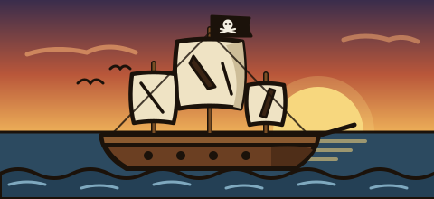
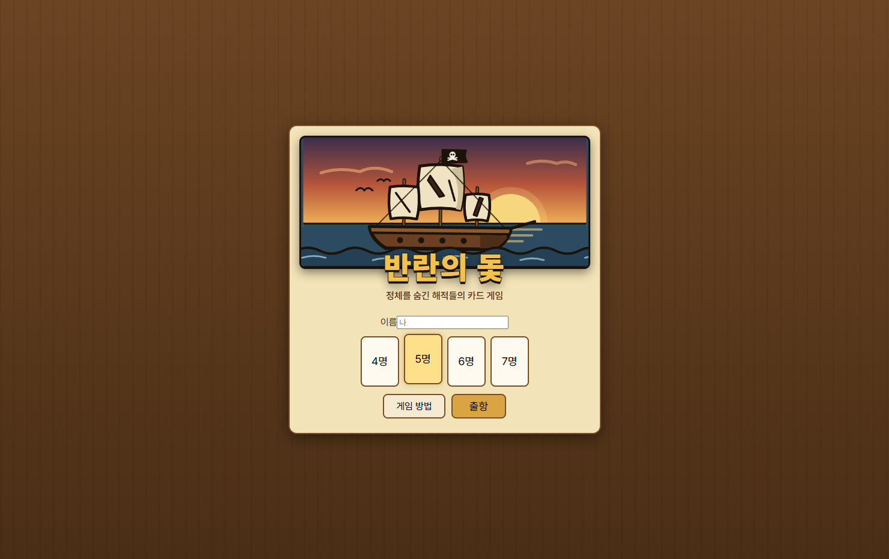
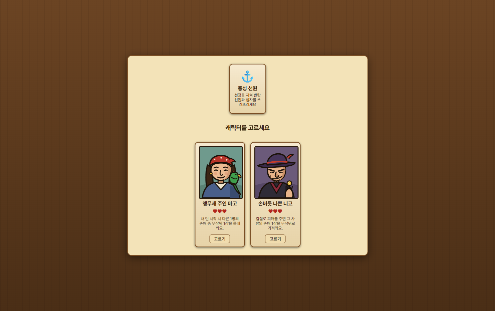
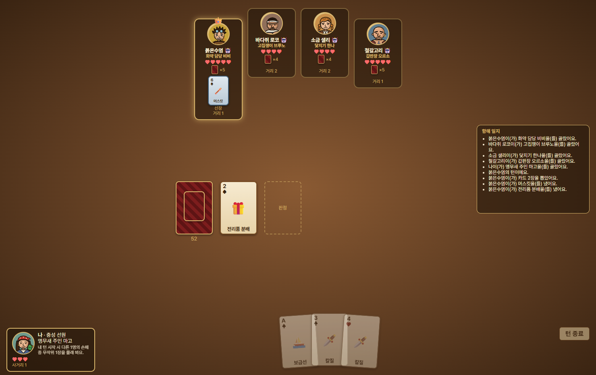
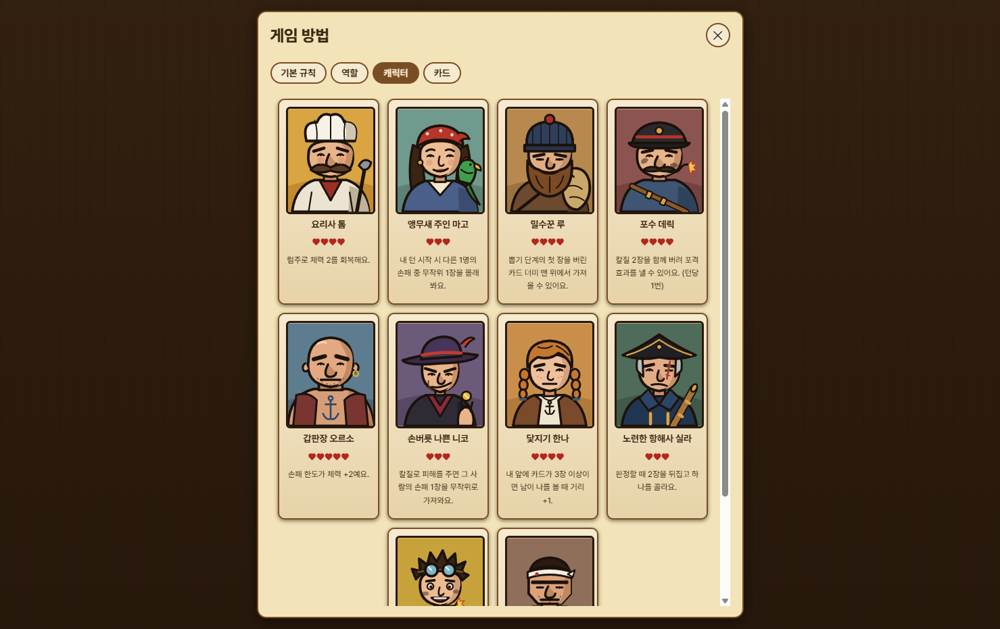

<p align="center">
  
</p>

<h1 align="center">반란의 돛</h1>

<p align="center"><b>정체를 숨긴 해적들의 카드 게임</b><br>
선장을 지킬 것인가, 배를 빼앗을 것인가. 누가 내 편인지 모르는 바다 위에서 칼을 겨눠요.</p>

---

## 어떤 게임인가요

4~7명이 해적선에 올라 각자 비밀 역할을 받아요. 선장만 정체가 공개되고, 나머지는 행동을 보고 누가 같은 편인지 짐작해야 해요.

| 역할 | 승리 조건 |
|---|---|
| 👑 선장 | 반란 선원과 첩자를 모두 쓰러뜨리기 |
| ⚓ 충성 선원 | 선장을 지켜 반란 선원과 첩자를 쓰러뜨리기 |
| 🏴‍☠️ 반란 선원 | 선장을 쓰러뜨리기 |
| 🕵️ 첩자 | 마지막까지 혼자 살아남기 |

내 턴에는 카드 2장을 뽑고, 칼질·피하기·럼주 같은 카드와 무기·망원경·작은 보트 같은 장비를 써요. 자리 사이의 거리와 무기 사거리가 공격 가능 여부를 정해요. 자세한 규칙은 게임 시작 화면의 **"게임 방법"** 버튼에서 볼 수 있어요.

지금은 **브라우저에서 AI 선원들과 하는 1인 플레이**를 지원해요. 친구들과 하는 온라인 플레이는 준비 중이에요.

## 스크린샷

| 시작 화면 | 역할 공개와 캐릭터 뽑기 |
|---|---|
|  |  |

| 게임 테이블 | 게임 방법: 캐릭터 |
|---|---|
|  |  |

## 특징

- **숨겨진 역할**: 선장, 충성 선원, 반란 선원, 첩자. 인원(4~7명)에 맞춰 역할이 배분돼요.
- **캐릭터 10명**: 역할을 확인한 뒤 캐릭터 2장 중 1장을 골라요. 요리사 톰, 앵무새 주인 마고, 포수 데릭처럼 캐릭터마다 고유 능력이 있어요.
- **카드 22종, 80장**: 즉시 사용 카드 12종(칼질, 결투, 포격, 소매치기 등)과 장비 10종(권총부터 선상 대포까지, 엄폐용 나무통, 화약통, 영창 등).
- **나무 갑판 테이블 화면**: 양피지 카드, 부채꼴 손패, 둘러앉은 상대. 카드를 뽑고 내고 맞는 장면이 애니메이션으로 보여요. 운영체제의 "동작 줄이기" 설정을 따라요.
- **AI 선원**: 공개된 행동만 보고 누가 적인지 추정하며 플레이해요. 남의 패는 엿보지 않아요.
- **게임 방법 안내**: 기본 규칙, 역할, 캐릭터, 카드 소개. 설명은 게임 데이터에서 그대로 가져와서 실제 규칙과 항상 같아요.
- 휴대폰 폭(360px)에서도 쓸 수 있어요.

## 실행하기

[Node.js](https://nodejs.org/) 18 이상이 필요해요.

```bash
npm install
npm run dev       # 개발 서버 (http://localhost:5173)
npm test          # 테스트
npm run build     # 타입 검사 + 배포용 빌드 (dist/)
```

`npm run build`로 만든 `dist/` 폴더는 정적 파일이라 GitHub Pages 같은 곳에 그대로 올릴 수 있어요. 외부 서버나 외부 폰트·이미지에 의존하지 않아요.

## 기술 스택

TypeScript · React 18 · Vite · Framer Motion · Vitest · Pretendard 폰트(번들 포함)

## 구조

게임 규칙과 화면, 연결 방식을 층으로 나눠서, 나중에 온라인 연결만 끼우면 멀티플레이가 되게 만들었어요.

```
src/
  engine/   게임 규칙 (카드·캐릭터 클래스, 턴 진행, 응답 대기, 승패 판정)
  host/     방장 세션: 엔진을 돌리고 플레이어별로 보일 정보만 골라 보냄
  net/      연결 인터페이스(Transport)와 같은 페이지 안 구현체
  ai/       규칙 기반 AI 플레이어
  ui/       React 화면, 애니메이션, 그림(art/)
docs/       설계 문서와 구현 계획
tests/      Vitest 테스트
```

## 브랜치

`main`이 항상 최신 상태예요. 작업은 기능별 브랜치에서 하고 `main`으로 합쳐요.

| 브랜치 | 작업한 내용 |
|---|---|
| `feat/stage1` | 1인 플레이, 캐릭터 뽑기, 나무 갑판 테이블 화면, 애니메이션 |
| `feat/portraits` | 폰트, 캐릭터 초상화, 타이틀 그림, 게임 방법 |

## 그림 바꾸기

- **캐릭터 그림**: `src/ui/art/portraits/{캐릭터id}.svg`에 캐릭터마다 하나씩 있어요. 같은 이름으로 덮어쓰면 바로 바뀌어요. PNG 같은 다른 형식은 파일을 넣고 `src/ui/art/portraits.ts`의 해당 `import` 경로만 바꾸면 돼요. 비율은 세로 166:200, 얼굴이 위쪽 2/3 안에 오게 그리면 동그란 얼굴로 잘릴 때도 잘 보여요. 그림이 없거나 못 불러오면 이모지로 대신 보여줘요.
- **타이틀 그림**: `src/ui/art/title.svg`를 덮어쓰면 바뀌어요.

## 앞으로 할 일

- 🌊 **바다 이벤트**: 라운드마다 폭풍, 순풍, 바다 괴물 같은 이벤트가 펼쳐져 규칙이 조금씩 바뀌어요.
- 🌐 **온라인 멀티플레이**: 방장 브라우저가 서버 역할을 하고, 친구들은 방 코드로 들어와요(WebRTC). 연결이 끊기면 AI가 자리를 이어받아요.
- 게임 중 규칙 보기 버튼, 효과음.
